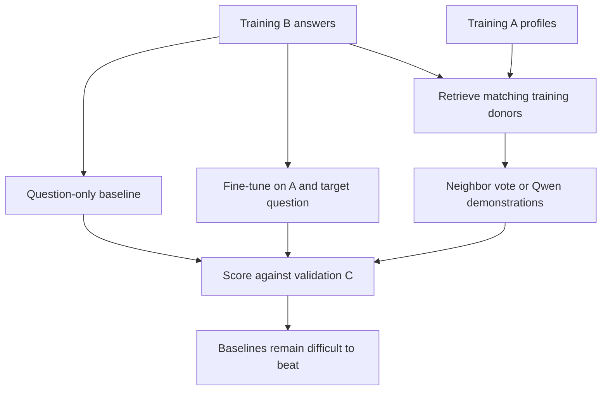

# Behavior prediction on Twin-2K-500

Predict a participant's later survey answers from their earlier profile using small language models and retrieved examples.

**Main finding:** strong question-only baselines remain difficult to beat. Full fine-tuning matches the baseline on the binary-choice pilot. Full-B epoch-1 Qwen LoRA reaches **73.49% pricing accuracy versus 73.41%** for the baseline, with no established statistically significant improvement. Retrieval methods also trail the baseline across the six main question groups.

**All reported results use development validation. The reserved 309-participant test set remains unscored.**

[Experiment presentation](Twin_2K_500_Experiments.pptx) · [Concise EDA](Twin_2K_500_EDA.ipynb)

## Files

| Path | Contents |
|---|---|
| `Twin_2K_500_Experiments.pptx` | Latest 17-slide presentation: setup, definitions and quantified results |
| `Twin_2K_500_EDA.ipynb` | Participant counts, question types, A/B differences and leakage example |
| `experiments/01_pilot/` | Qwen/Liquid zero-shot inference, LoRA, full tuning and Qwen cross-validation |
| `experiments/02_full_b_lora/` | Full-B Qwen LoRA training and evaluation |
| `experiments/03_epoch1_comparisons/` | Fixed epoch-1 inference, profile ablations, lexical retrieval and pricing baselines |
| `experiments/04_embedding_all_options/` | Frozen embedding retrieval with all options in the profile representation |
| `experiments/05_embedding_selected/` | Frozen embedding retrieval using selected-answer representations |
| `experiments/setup/` | Required workspace preparation |
| `experiments/requirements.txt` | Python dependencies |

This source package contains training/inference entry points and their required data, prompt, scoring and integrity helpers. Required configurations and the answer-free question catalog are included. Standalone tests, debugging experiments, result exports, logs, checkpoints, model weights, raw data, diagrams and extra reports are excluded. A few dependency filenames contain `diagnose` or `test`; their shared functions are imported by the retained pipelines. They are not additional experiments to run.

## Data and terminology

| Component | Meaning | Use |
|---|---|---|
| **A** | Earlier questions and answers not repeated in wave 4 | Participant profile input |
| **B** | Earlier answers to repeated questions | Training labels and training-donor answers |
| **C** | Later answers to those repeated questions | Primary evaluation reference |

The dataset contains **2,058 people**. The participant split is **1,440 train / 309 validation / 309 test**, with all records for one person kept together. The pinned dataset revision is `f883165a3026fde855dfd448e0cd16443ab257b6`.

**Leakage trap:** the merged full-persona field can contain later C answers. For training participant 574, QID158 has B = 3, C = 4 and full persona = 4. Model inputs therefore use wave-split A plus an answer-free target question. Baselines and retrieval donors use training participants only.

**Questions vary across people.** A has 150 shared exact question definitions, with 156-158 records per person. B has 63 administered records per person, but randomized branches, product prices and slot order change the actual questions. Pricing matches the **product and exact price**, not QID alone. Matrix rows expand into separate answer targets.

**Binary-choice pilot** is a question subset: five scenarios represented by nine binary QIDs. Country anchors, redwood anchors, discounts and lotteries each have two alternative versions; the marble-tray scenario has one. Each person answers five, giving **7,200 training / 1,545 validation examples**. Later tables call this group **pilot subset accuracy**, including when the model was trained on full B.

**Question-only baseline** is a prediction rule: take the most common training B answer for the same target condition, or the median for ordered/numeric answers. It uses no A profile and no LLM. The exact question, price, anchor and matrix item are matched where applicable. Top-five retrieval instead uses only the five nearest eligible training participants.



## Setup and validation results

Full-B Qwen2.5-0.5B-Instruct uses rank-8 LoRA, alpha 16, dropout 0.05, learning rate `1e-4`, and batch 16 with accumulation 2. There are **4,399,104 trainable adapter parameters / 498,431,872 total parameters**. The reported checkpoint is **epoch 1, step 4,321, from a three-epoch learning-rate schedule**. Training uses **138,264 scalar B targets**; validation contains **29,690 scalar cases**. Prompt and padding tokens are masked from the loss.

Whole A units are selected within a token budget, so fine-tuning does not include every A response. Retrieval embeds A in chunks and fits five demonstrations using shared question definitions. The frozen **Qwen3-Embedding-0.6B** model is an additional retrieval experiment outside the sub-0.5B fine-tuning constraint. Retrieved demonstrations use the original Qwen answering model without an adapter. No reranker is used.

| Question group / metric | Question-only baseline | Epoch-1 LoRA | Selected-answer top-5 | Qwen + selected neighbors |
|---|---:|---:|---:|---:|
| Pricing accuracy ↑ | 73.41% | 73.49% | 69.13% | 47.01% |
| Pilot subset accuracy ↑ | 72.52% | 67.09% | 66.79% | 44.97% |
| Nominal matrix accuracy ↑ | 74.60% | 74.60% | 74.51% | 74.54% |
| Ordinal normalized error ↓ | 0.2041 | 0.2204 | 0.2321 | 0.2818 |
| Ordinal matrix normalized error ↓ | 0.1903 | 0.1923 | 0.2172 | 0.3322 |
| Bounded numeric normalized error ↓ | 0.1959 | 0.2100 | 0.2258 | 0.3066 |

| Binary-choice pilot | Zero-shot | LoRA | Full fine-tuning |
|---|---:|---:|---:|
| Qwen2.5-0.5B-Instruct | 44.76% | 65.74% | 72.52% |
| Liquid LFM2.5-350M | 51.00% | 66.42% | 72.52% |

The pilot question-only baseline is **72.52%**; human B/C consistency is **76.73%**. The early Qwen prompt differs from later fine-tuning prompts, so this is an experiment inventory rather than a controlled estimate of the entire training gain. Qwen three-fold development CV gives **72.39%** out-of-fold accuracy versus **72.80%** for the baseline. Fold SD is **0.64 percentage points**, not a confidence interval.

Scores average within each QID and then across QIDs. Nominal questions use accuracy; ordered questions use absolute rank error divided by `K - 1`; bounded numbers use absolute error divided by the allowed range. Unbounded numeric MAE and median absolute error retain original units and are reported separately in the presentation. Human B/C consistency is a reference, not a strict ceiling. Repeated validation use limits final generalization claims.

## Run

Use Linux, Python 3.12 and CUDA-enabled PyTorch 2.8.0. Historical fine-tuning used a 48 GB NVIDIA GPU. The protocol-critical Transformers, Accelerate and PEFT versions are pinned; this is not a complete historical environment lockfile.

From the repository root, set paths to your local models and a private workspace outside the repository:

```bash
python -m pip install -r experiments/requirements.txt
export RUN_ROOT="$PWD/../twin_work"
export DATASET="$RUN_ROOT/data/Twin-2K-500"
export QWEN=/root/autodl-tmp/models/Qwen2.5-0.5B-Instruct
export LIQUID=/root/autodl-tmp/models/LFM2.5-350M
export EMBEDDING=/root/autodl-tmp/models/Qwen3-Embedding-0.6B

python experiments/01_pilot/download_data.py --destination "$DATASET"
python experiments/01_pilot/prepare_data.py --root "$RUN_ROOT" --dataset-dir "$DATASET"
```

Reuse existing local model folders or obtain the model snapshots linked below. If data is already downloaded, set `DATASET` to that directory and skip the download. Data preparation verifies the pinned snapshot and established participant split. Pass `--split-manifest /path/to/participant_split.csv` to preserve an existing compatible split.

### Binary-choice pilot

```bash
# Review the run sequence without launching training.
python experiments/01_pilot/run_experiments.py plan \
  --experiments qwen_full --workspace "$RUN_ROOT" --dataset-dir "$DATASET" \
  --qwen-model "$QWEN" --liquid-model "$LIQUID"
```

Replace `plan` with `run` to execute. Other retained groups are `qwen_lora`, `liquid_lora`, `liquid_full` and `cv`; `list` displays available stages. Dependencies run first. The Qwen full-tuning chain uses genuine Liquid LoRA preparation to preserve the historical input-selection policy. CV trains fresh models for three fixed epochs per fold; participant 574 remains training-only.

### Full-B training and fixed epoch-1 inference

Run the pilot `qwen_full` chain first. Full-B requires genuine `outputs/qwen_full_v1/run_config.json` and `outputs/liquid_lora_v1/run_config.json`, with matching model/tokenizer fingerprints. Do not create dummy metadata or remove the verification checks.

```bash
python experiments/setup/prepare_workspace.py --workspace "$RUN_ROOT"
python "$RUN_ROOT/qwen_full_b_lora_scripts/train_qwen_full_b_lora.py" \
  --root "$RUN_ROOT" --model "$QWEN" --selection-model "$LIQUID" \
  --out outputs/qwen_full_b_lora_v4_b16_a2 \
  --epochs 3 --learning-rate 0.0001 \
  --micro-batch-size 16 --gradient-accumulation 2

python experiments/03_epoch1_comparisons/epoch1_comparisons/infer_qwen_full_b_epoch1.py \
  --root "$RUN_ROOT" --scripts-dir "$RUN_ROOT/qwen_full_b_lora_scripts" \
  --run outputs/qwen_full_b_lora_v4_b16_a2 --batch-size 1
```

The reported adapter is `outputs/qwen_full_b_lora_v4_b16_a2/epoch_adapters/epoch-1`. Setting `--epochs 1` changes the learning-rate schedule and does not reproduce the reported setup. The command above retains epoch snapshots; inference explicitly uses epoch 1.

### Profile ablations and lexical retrieval

```bash
python experiments/03_epoch1_comparisons/epoch1_comparisons/run_comparisons.py \
  --root "$RUN_ROOT" --scripts-dir "$RUN_ROOT/qwen_full_b_lora_scripts" \
  --run outputs/qwen_full_b_lora_v4_b16_a2 \
  --out outputs/qwen_epoch1_comparisons_v1 --batch-size 1
```

This compares original A, removed A and shuffled A using the same adapter, and includes lexical retrieval and pricing baselines. Profile swaps preserve the recipient's target condition and C reference. Add `--check-only` for preflight.

### Embedding retrieval

```bash
python experiments/05_embedding_selected/qwen_embedding_selected/run_retrieval.py \
  --root "$RUN_ROOT" --dataset-dir "$DATASET" \
  --embedding-model "$EMBEDDING" --generator-model "$QWEN" \
  --own-a-budget 1600 --donor-a-budget 1600 \
  --max-input-tokens 12288 --generation-batch-size 4 \
  --out outputs/embedding_selected_v1 --stage all
```

For all-options embeddings, use `experiments/04_embedding_all_options/qwen_embedding_shared/run_retrieval.py` with a different output directory. Use `--stage knn` for direct neighbor vote/median only; this still uses the embedding model. Neither embedding method requires a fine-tuned adapter.

### EDA

The EDA uses one full-persona chunk solely to demonstrate the leakage trap. Keep it separate from model inputs:

```bash
hf download LLM-Digital-Twin/Twin-2K-500 \
  full_persona/chunks/persona_chunk_001.parquet \
  --repo-type dataset --revision f883165a3026fde855dfd448e0cd16443ab257b6 \
  --local-dir "$DATASET"
export TWIN_DATA_ROOT="$DATASET"
export TWIN_SPLIT_PATH="$RUN_ROOT/data/participant_split.csv"
jupyter lab Twin_2K_500_EDA.ipynb
```

Use fresh output directories with this curated source package. Source paths and directory fingerprints are recorded by the engines; resuming a historical run requires its original frozen source tree. Exact numerical reproduction also depends on the original model snapshots, tokenizers and environment. No GPU training or inference was rerun during packaging, and no documented command evaluates the reserved test set.

## References

- [Twin-2K-500 paper](https://arxiv.org/abs/2505.17479) and [official dataset](https://huggingface.co/datasets/LLM-Digital-Twin/Twin-2K-500).
- [Qwen2.5-0.5B-Instruct](https://huggingface.co/Qwen/Qwen2.5-0.5B-Instruct).
- [Liquid LFM2.5-350M](https://huggingface.co/LiquidAI/LFM2.5-350M).
- [Qwen3-Embedding-0.6B](https://huggingface.co/Qwen/Qwen3-Embedding-0.6B).
- [LoRA](https://arxiv.org/abs/2106.09685).

This is a separate experimental protocol, not an exact reproduction of the paper's split, models or published score. Dataset and model licenses remain with their respective upstream projects.
